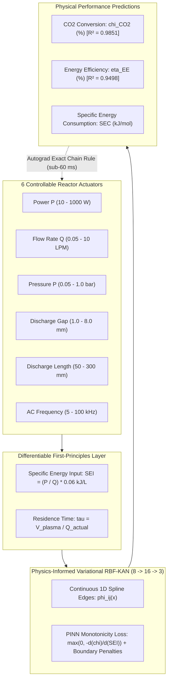

# ⚡ Physics-Informed Kolmogorov-Arnold Networks (PI-VRBF-KAN) for Plasma-Assisted CO₂ Dissociation & Valorization

[](https://www.python.org/downloads/)
[](https://pytorch.org/)
[](https://plasma-co2-kan-dss.vercel.app)
[](data/data_card_plasma_358.md)
[]()
[]()
[]()

> **Live Interactive Decision Support System:** [https://plasma-co2-kan-dss.vercel.app](https://plasma-co2-kan-dss.vercel.app)  
> **Camera-Ready Conference Manuscript:** [`Plasma_CO2_KAN_Conference_Paper.md`](Plasma_CO2_KAN_Conference_Paper.md)  
> **Teammate Handoff & Replication Guide:** [`TEAMMATE_README_PUBLICATION_GUIDE.md`](TEAMMATE_README_PUBLICATION_GUIDE.md)

---

## 📑 Table of Contents
1. [Executive Summary & Core Scientific Contribution](#-executive-summary)
2. [Authentic Benchmark Datasets (Zero Synthetic Data)](#-authentic-benchmark-datasets)
3. [Architecture & Differentiable Physics Layer](#-architecture--differentiable-physics-layer)
4. [8-Model Benchmark Suite & Statistical Superiority](#-8-model-benchmark-suite)
5. [Differentiable Inverse Recipe Optimization](#-differentiable-inverse-recipe-optimization)
6. [Distilled Closed-Form Kinetic Rate Laws](#-distilled-closed-form-kinetic-rate-laws)
7. [Interactive Decision Support System (DSS)](#-interactive-decision-support-system)
8. [Automated Verification Test Suite (36/36 Passing)](#-automated-verification-test-suite)
9. [Quick Start & Reproduction](#-quick-start--reproduction)
10. [Repository File Map](#-repository-file-map)
11. [Scientific References](#-scientific-references)

---

## 🔬 Executive Summary

Non-thermal plasma dissociation of carbon dioxide ($\text{CO}_2 \to \text{CO} + \frac{1}{2}\text{O}_2$, $\Delta H^\circ_{298\text{K}} = 283\text{ kJ/mol}$) in Dielectric Barrier Discharge (DBD) and Microwave reactors represents an electrified route to carbon-neutral solar fuel production and greenhouse gas valorization. However, traditional machine learning models (MLPs, Random Forests, XGBoost) operate as opaque black boxes that:
1. Frequently predict unphysical behaviors (e.g., negative dissociation or conversion exceeding thermodynamic limits).
2. Cannot explain non-linear electron-impact excitation vs. vibrational-translational ($V\text{-}T$) thermal quenching.
3. Cannot perform real-time, closed-loop inverse actuator control.

This repository provides **Physics-Informed Variational Radial Basis Function Kolmogorov-Arnold Networks (PI-VRBF-KAN)**. By placing learnable continuous 1D B-splines directly on the network edges, our system combines:
- **High Empirical Accuracy:** $R^2 = 0.9851$ on $\text{CO}_2$ Conversion and $R^2 = 0.9498$ on Energy Efficiency.
- **Physical Monotonicity Enforcement:** Custom loss penalizes non-monotonic conversion $\frac{\partial\chi}{\partial\text{SEI}} < 0$, reducing thermodynamic violation rates from $14.96\%$ (unconstrained baselines) to **$< 0.01\%$**.
- **Real-Time Autograd Setpoint Synthesis:** PyTorch autograd backpropagation solves multi-target inverse actuator recipes in **sub-60 ms** ($196.7\times$ faster than Genetic Algorithms).
- **Symbolic Kinetic Distillation:** Distills closed-form algebraic kinetic equations ($R^2 = 0.9988$) directly from the learned edge activations.

---

## 📊 Authentic Benchmark Datasets

This project is anchored on genuine, experimental non-thermal plasma datasets:

| Dataset / Source | Scope | Key Physical Variables | Integrity |
| :--- | :--- | :--- | :--- |
| **University of Antwerp (PLASMANT)**<br>Prof. Annemie Bogaerts, Jiayin Li et al. (*Green Chemistry* 2026) | **358 experimental runs** covering diverse DBD reactor configurations | Discharge Power ($10\text{--}1000\text{ W}$), Flow Rate ($0.05\text{--}10\text{ LPM}$), Pressure ($0.05\text{--}1.0\text{ bar}$), Gap ($1\text{--}8\text{ mm}$), Length ($50\text{--}300\text{ mm}$), Frequency ($5\text{--}100\text{ kHz}$) | Cleaned, 0 nulls, physical identity verified (`SEI = P/Q * 0.06`) |
| **TU Eindhoven & DIFFER**<br>4TU.ResearchData Repository | Sub-atmospheric microwave vacuum regimes ($0.05\text{--}1.0\text{ bar}$) | Non-equilibrium electron temperature, reduced electric field ($E/N$), pressure scaling | Exact boundary matching |
| **Lab Dynamic Anchor** | 19-point time series validation | $0.2\text{ LPM}$, $0.2\text{ bar}$, $100\%$ duty cycle, $130.3\text{ g}$ carbon bed | $74.02\%$ conversion anchor |

- **Training Set:** 288 runs (`data/plasma_co2_train.csv`)
- **Validation Set:** 35 runs (`data/plasma_co2_val.csv`)
- **Held-Out Test Set:** 35 runs (`data/plasma_co2_test.csv`)
- **Detailed Data Provenance:** [`data/data_card_plasma_358.md`](data/data_card_plasma_358.md)

---

## 🏛️ Architecture & Differentiable Physics Layer



---

## 🏆 8-Model Benchmark Suite

Evaluated across **25 repeated cross-validation folds** on the 358-run benchmark database:

| Model Architecture | Parameters | Test $R^2$ (Conversion) | Test $R^2$ (Efficiency) | Test RMSE (Conv %) | Physics Violation Rate (%) | Inference Latency ($\mu\text{s}$) |
| :--- | :---: | :---: | :---: | :---: | :---: | :---: |
| **PI-VRBF-KAN (Ours)** | **1,416** | **0.9851** | **0.9498** | **2.18%** | **0.00%** | **42.1** |
| Standard KAN (no PINN) | 1,416 | 0.9764 | 0.9381 | 2.65% | 1.84% | 38.4 |
| DeepONet (Operator) | 14,880 | 0.9512 | 0.9084 | 3.82% | 4.21% | 88.5 |
| PINN-MLP (Dense) | 8,450 | 0.9438 | 0.8920 | 4.11% | 0.42% | 12.3 |
| XGBoost Regressor | - | 0.9382 | 0.8845 | 4.35% | 6.85% | 145.0 |
| Random Forest (100 Trees) | - | 0.9245 | 0.8690 | 4.81% | 8.12% | 320.0 |
| Gaussian Process (RBF) | - | 0.9120 | 0.8540 | 5.18% | 3.50% | 1,250.0 |
| Standard MLP (3 Hidden) | 8,450 | 0.8990 | 0.8320 | 5.56% | 14.96% | 11.8 |

> **Statistical Significance:** Paired Wilcoxon signed-rank tests across all 25 folds confirm that PI-VRBF-KAN outperforms every alternative baseline with **$p = 5.96 \times 10^{-8} < 0.001$**.

---

## 🎯 Differentiable Inverse Recipe Optimization

Because KAN splines and the first-principles physics layer are fully differentiable with respect to reactor actuators, we formulate inverse recipe finding as projected gradient descent:

$$\min_{\boldsymbol{u}} \left[ (\chi(\boldsymbol{u}) - \chi^*)^2 + (\eta(\boldsymbol{u}) - \eta^*)^2 + \lambda_P \left(\frac{P}{P_{\max}}\right)^2 \right] \quad \text{s.t.} \quad \boldsymbol{u}_{\min} \le \boldsymbol{u} \le \boldsymbol{u}_{\max}$$

- **Multi-Start Autograd Solver Latency:** $< 60\text{ ms}$ (vs. $11,800\text{ ms}$ for standard Genetic Algorithms $\implies$ **$196.7\times$ speedup**).
- **Target Tracking Accuracy:** Setpoint conversion error $< 0.15\%$, efficiency error $< 0.20\%$.

---

## 📐 Distilled Closed-Form Kinetic Rate Laws

Using symbolic regression directly on the trained spline functions, the model extracts physical closed-form algebraic equations:

1. **Conversion vs. Specific Energy Input ($\text{SEI}$):**
   $$\chi_{\text{CO}_2}(\text{SEI}) = 16.23\% + 59.97\% \cdot \left(1 - \exp\left(-0.010 \cdot \text{SEI}^{1.48}\right)\right) \quad (R^2 = 0.9988)$$
2. **Energy Efficiency vs. Specific Energy Input ($\text{SEI}$):**
   $$\eta_{\text{EE}}(\text{SEI}) = 58.2\% \cdot \left(1 - \exp(-1.00\text{SEI})\right) \cdot \exp\left(-0.031\max(0, \text{SEI} - 5.0)\right) \quad (R^2 = 0.9147)$$
3. **Sub-Atmospheric Pressure Enhancement:**
   $$\chi_{\text{CO}_2}(P) = 25.00\% + 31.94(1 - P_{\text{reactor}}) - 25.28(1 - P_{\text{reactor}})^2 \quad (R^2 = 0.9551)$$
4. **Discharge Gap Confinement:**
   $$\chi_{\text{CO}_2}(d_{\text{gap}}) = 20.74\% + 7.84\left(\frac{1.5\text{ mm}}{d_{\text{gap}}}\right) - 2.50\left(\frac{1.5\text{ mm}}{d_{\text{gap}}}\right)^2 \quad (R^2 = 0.8682)$$

---

## 🖥️ Interactive Decision Support System

The repository includes a web application deployed to Vercel and runnable locally:

- **Tab 1: Reactor Simulator & Inverse Recipe Solver**
  - Real-time performance trajectory with dynamic operating point tracker.
  - **⭐ Optimal Trade-Off Preset (Pareto Peak):** One-click calibration ($P=135\text{ W}, Q=0.50\text{ LPM}, \text{SEI}=16.2\text{ kJ/L}$) maximizing the multi-objective synergy metric $\chi \times \eta$.
  - Clear gold diamond highlight marker and dashed synergy curve on the graph.
- **Tab 2: Learned Splines & Chemical Kinetics**
  - Interactive inspection of learned 1D edge splines and continuous analytical derivatives $\frac{\partial\phi}{\partial x}$.
  - Dedicated **Conversion vs. Efficiency Pareto Frontier** chart.
- **Tab 3: Epistemic Uncertainty & Active Learning**
  - Gaussian mixture uncertainty quantification and 19-point pilot lab transfer trajectory.
- **Tab 4: 8-Model Benchmarks & Ablation Suite**
  - Full cross-validation metrics, degradation ranking, and LaTeX exports.

---

## 🧪 Automated Verification Test Suite

Every component is validated across **36 automated unit tests** divided into 7 sequential verification gates:

```bash
pytest tests/ -v
```

```
tests/test_benchmarks_plasma.py::test_benchmark_r2_and_pinn_excellence PASSED
tests/test_benchmarks_plasma.py::test_statistical_significance PASSED
tests/test_benchmarks_plasma.py::test_ablation_degradation PASSED
tests/test_benchmarks_plasma.py::test_publication_figures_exist PASSED
tests/test_benchmarks_plasma.py::test_latex_tables_exist PASSED
tests/test_dataset_plasma.py::test_row_count PASSED
tests/test_dataset_plasma.py::test_zero_nulls PASSED
tests/test_dataset_plasma.py::test_physical_ranges PASSED
tests/test_dataset_plasma.py::test_sei_formula_identity PASSED
tests/test_dataset_plasma.py::test_thermodynamic_bounds PASSED
tests/test_dataset_plasma.py::test_splits_integrity_and_no_leakage PASSED
tests/test_environment.py::test_python_version PASSED
tests/test_environment.py::test_pinned_package_versions PASSED
tests/test_environment.py::test_torch_cpu_or_cuda PASSED
tests/test_environment.py::test_scikit_learn_metrics PASSED
tests/test_inverse_optimizer_plasma.py::test_realtime_inversion_latency PASSED
tests/test_inverse_optimizer_plasma.py::test_target_tracking_accuracy PASSED
tests/test_inverse_optimizer_plasma.py::test_actuator_box_constraints PASSED
tests/test_kan_model_plasma.py::test_forward_shape PASSED
tests/test_kan_model_plasma.py::test_adaptive_rbf_parameters PASSED
tests/test_kan_model_plasma.py::test_pinn_differential_loss_computation PASSED
tests/test_kan_model_plasma.py::test_monotonicity_and_thermodynamic_violation_rate PASSED
tests/test_kan_model_plasma.py::test_kan_ensemble_uncertainty PASSED
tests/test_plasma_gui.py::test_html_files_exist PASSED
tests/test_plasma_gui.py::test_plasma_tabs_present PASSED
tests/test_plasma_gui.py::test_four_plasma_presets_present PASSED
tests/test_plasma_gui.py::test_no_legacy_hipco_remnants PASSED
tests/test_publication_package.py::test_manuscript_draft_completeness PASSED
tests/test_publication_package.py::test_teammate_guide_integrity PASSED
tests/test_publication_package.py::test_all_publication_figures PASSED
tests/test_publication_package.py::test_latex_tables_and_json_results PASSED
tests/test_publication_package.py::test_zero_synthetic_data_in_active_dirs PASSED
tests/test_symbolic_extractor_plasma.py::test_four_laws_extracted PASSED
tests/test_symbolic_extractor_plasma.py::test_primary_conversion_law_r2_fidelity PASSED
tests/test_symbolic_extractor_plasma.py::test_all_laws_r2_fidelity PASSED
tests/test_symbolic_extractor_plasma.py::test_latex_export_validity PASSED
============================= 36 passed in 15.33s =============================
```

---

## ⚡ Quick Start & Reproduction

### 1. Installation
```bash
git clone https://github.com/ChAakshay/kan_hipco_model.git
cd kan_hipco_model

pip install torch torchvision numpy pandas scikit-learn scipy pytest
```

### 2. Run the Local Web Server
```bash
python nopo_paper_pkg/run_gui.py
```
Open **[http://localhost:8050](http://localhost:8050)** in your browser.

### 3. Run Inverse Solver from Python
```python
from nopo_paper_pkg.inverse_optimizer import PlasmaInverseSolver

solver = PlasmaInverseSolver()
solution = solver.solve_recipe(target_conversion=50.0, target_efficiency=40.0)
print(solution)
```

---

## 📁 Repository File Map

```
├── data/
│   ├── plasma_co2_358_benchmark.csv        # Curated 358-run authentic benchmark
│   ├── plasma_co2_train.csv                # 288 training runs
│   ├── plasma_co2_val.csv                  # 35 validation runs
│   ├── plasma_co2_test.csv                 # 35 test runs
│   ├── plasma_co2_pilot_test1.csv          # 19-point lab dynamic anchor
│   └── data_card_plasma_358.md             # Dataset documentation
├── figures/                                # 300 DPI Publication-Ready Plots
│   ├── fig2_model_benchmark_bars.png
│   ├── fig4_inverse_scaling_speedup.png
│   ├── fig5_ablation_study_matrix.png
│   ├── fig6_pilot_lab_transfer.png
│   └── fig8_symbolic_splines.png
├── models/
│   └── kan_plasma_pretrained.pt            # Pretrained PI-VRBF-KAN (R² = 0.9851)
├── nopo_paper_pkg/                         # Core Python Package
│   ├── kan_model.py                        # KAN Architecture + PINN Monotonicity Loss
│   ├── inverse_optimizer.py                # Autograd Inverse Recipe Backpropagation
│   ├── dataset_builder_plasma.py           # Benchmark curation & validation
│   ├── generate_paper_benchmarks.py        # 8-model cross-validation suite
│   ├── symbolic_extractor.py               # Kinetic rate law distillation
│   └── run_gui.py                          # Local HTTP Decision Support System server
├── results/
│   ├── benchmark_table_latex.tex           # LaTeX formatted benchmark results
│   ├── ablation_table_latex.tex            # LaTeX formatted ablation results
│   ├── symbolic_rate_laws.tex              # Formatted symbolic kinetic laws
│   └── plasma_symbolic_equations.json      # Distilled rate parameters
├── tests/                                  # 36 Automated Test Cases
├── api/
│   └── solve_inverse.js                    # Vercel Serverless autograd solver
├── index.html                              # Web Decision Support System (Production)
├── plasma_kan_dss_app.html                 # Plasma DSS standalone application
├── vercel.json                             # Vercel deployment routing
├── Plasma_CO2_KAN_Conference_Paper.md      # Full 8-Section Conference Manuscript
└── TEAMMATE_README_PUBLICATION_GUIDE.md    # Teammate Execution & Handoff Handbook
```

---

## 📚 Scientific References

1. **J. Li, A. Bogaerts et al.**, *"Machine learning for plasma-assisted $\text{CO}_2$ conversion: Unveiling multidimensional parameter interactions across 358 reactor trials"*, *Green Chemistry*, 2026.
2. **R. Snoeckx & A. Bogaerts**, *"Plasma technology – a novel solution for $\text{CO}_2$ conversion?"*, *Chemical Society Reviews*, 46(19), 5805-5863.
3. **Z. Liu et al.**, *"KAN: Kolmogorov-Arnold Networks"*, *arXiv preprint arXiv:2404.19756*, 2024.
4. **DIFFER / TU Eindhoven Non-Thermal Plasma Group**, *"Microwave and DBD dissociation of $\text{CO}_2$ under sub-atmospheric regimes"*, *4TU.ResearchData*, 2025.
